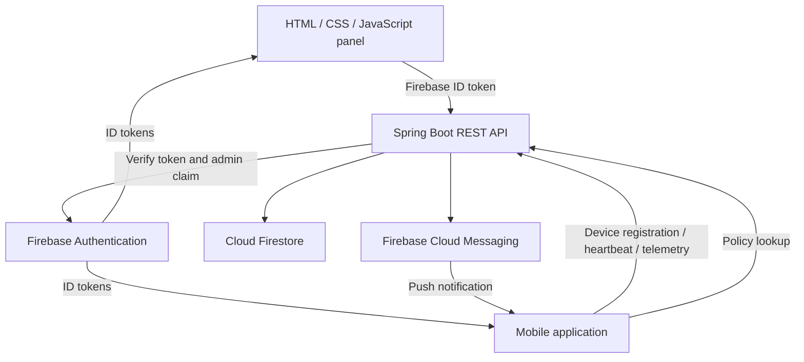

# AppControl — Mobile Application Control Panel

A formal, responsive administration panel built with **HTML, CSS and vanilla JavaScript**, served by **Java 17 / Spring Boot 3.5**. Firebase Authentication protects the APIs, Firestore stores operational data, and Firebase Cloud Messaging sends push notifications.

## التشغيل السريع

المشروع يحتوي على الواجهة والباك إند Java Spring Boot. وضع المعاينة يعمل بدون حساب Firebase ويستخدم بيانات تجريبية واضحة؛ لا يرسل إشعارات حقيقية. لتفعيل البيانات الحقيقية، اتبع ملف [إعداد Firebase](docs/FIREBASE_SETUP.md).

Requirements: Java 17+ and Maven 3.6.3+.

```sh
mvn spring-boot:run
```

Open **http://localhost:8080**. Swagger: **http://localhost:8080/swagger-ui.html**.

```sh
mvn clean verify
java -jar target/appcontrol-panel-1.0.0.jar
```

The default server starts without Firebase credentials. Protected endpoints remain protected, and live data operations return `503` until Firebase is configured. There is no default admin password or server-side authentication bypass. The browser starts in an explicitly labelled demo workspace; demo settings/history persist only in localStorage (`appcontrol-demo-v1`).

## Included

- Overview: registered users, recent heartbeats, unique installations, multi-device accounts.
- User directory: search loaded users, filter presence/device count, inspect devices and requests.
- Push notifications: single/multiple user IDs, mobile preview, confirmation, history, FCM acceptance/failure counts; idempotent request keys.
- Requests and logs: user filter, feature, HTTP method/path, status, duration, sanitized problem message.
- Android/iOS policy: independent latest/minimum build numbers, release labels, official store URLs, forced/optional update decisions.
- Maintenance: enable/disable and localized Arabic/English messages; maintenance takes precedence over updates.
- Firebase admin login, authenticated REST APIs, generated OpenAPI/Swagger, tests, Dockerfile and GitHub Actions.
- Responsive desktop/tablet/mobile layout. Admin interface is English; user-facing policy messages support Arabic/English with RTL preview.

## Architecture



## Documentation

- [Firebase setup and deployment](docs/FIREBASE_SETUP.md)
- [API contract and mobile integration](docs/API.md)
- [Data model, semantics and operational considerations](docs/DATA_MODEL.md)

## Project layout

```text
src/main/java/com/appcontrol/panel/  Spring Boot API, security and Firebase services
src/main/resources/static/          HTML, CSS, JavaScript and public web config
src/test/java/com/appcontrol/panel/  Policy and security tests
docs/                              Setup, API and data model
```

## Important scope

The live backend is implemented, but a Firebase project, credentials, admin account and mobile integration are required for real data and real pushes. No Firebase project is provisioned automatically. “Online” means a heartbeat within five minutes. “Installations” means registered installation IDs, not App Store/Google Play download statistics. Telemetry is explicitly sent by the app, not intercepted automatically. The illustrative activity chart is shown only in demo mode; live mode shows actual recorded totals.

Before production, add infrastructure rate limiting/App Check, monitoring, retention policy and your domain/TLS configuration. The panel is a single Firebase project workspace, not a multi-tenant SaaS. See the operational notes for paging, notification retries and scale limits.
